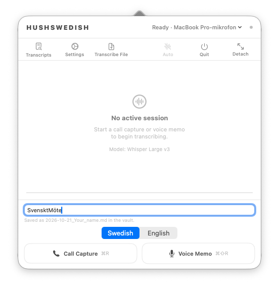
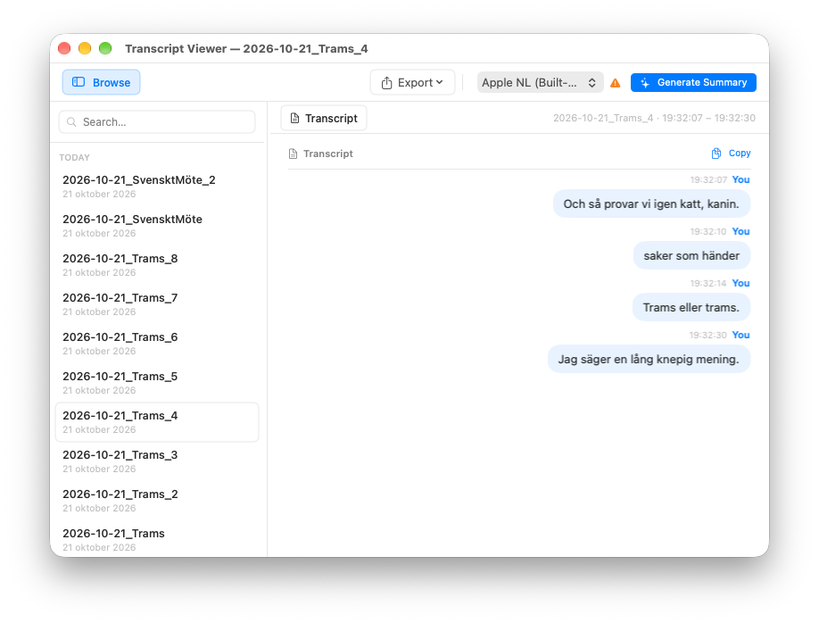

<p align="center">
  
</p>

<h1 align="center">HushSwedish</h1>

<p align="center">
  <strong>On-device meeting & voice transcription for macOS — built for Swedish and English.</strong><br/>
  No cloud. No API keys. Markdown in your vault.
</p>

<p align="center">
  
  
  
  
</p>

---

HushSwedish is a **personal fork** of [HushScribe](https://github.com/drcursor/HushScribe) ([hushscribe.app](https://hushscribe.app/)). It is **not** affiliated with or maintained by the upstream project. Same local-first idea — menu bar capture, on-device models, `.md` transcripts — with changes tuned for **Swedish meetings** and for **running next to** the official app (`com.drcursor.hushscribe` vs `com.hushswedish.app`).

<p align="center">
  
  
  
</p>

## Changes from original HushScribe

| Topic | Upstream | HushSwedish |
|--------|----------|-------------|
| Default ASR model | Parakeet-TDT v3 | **Whisper Large v3** |
| Session language | Auto / model-default | **SV or EN** before each recording |
| Transcript filenames | Timestamp + label | Optional **`yyyy-MM-dd_Your_title.md`** |
| Pause / Stop | Can drop trailing speech | **Flushes last sentence** through ASR first |
| Voice Memo | Starts system-audio capture | **Mic only** (no screen-recording prompt) |
| Parakeet download | Could block other models | **Only when Parakeet is selected** |
| App identity | HushScribe | **HushSwedish**, separate prefs & vaults |
| Default vaults | HushScribe folders | **`~/Documents/HushSwedish/Meetings`** & **`Voice`** |
| Model cache on disk | Shared system paths | **Same** — no second Whisper download if you use both apps |
| Summary model download | Loads the model into MLX as it downloads | **Downloads the files only**, so a missing Metal library cannot quit the app |

**Also in this fork:**

- Whisper decoding uses explicit **`sv` / `en`** (transcribe, not translate); default session language **Swedish**; `transcription_language` in frontmatter.
- Transcript Viewer **dedupes** files when Meetings and Voice point at the same folder.
- Local **`scripts/release.sh test`** ad-hoc-signs when no Developer ID is configured (screen-recording permission may need re-granting after rebuilds).
- **`scripts/release.sh`** builds **`mlx.metallib`** into the app. Without it, generating a summary quits the process. The script stops if the Metal toolchain is missing (`xcodebuild -downloadComponent MetalToolchain`).

Full details: [docs/changes-from-hushscribe.md](docs/changes-from-hushscribe.md) · Language design: [docs/plan-recording-language-sv-en.md](docs/plan-recording-language-sv-en.md)

## Install (build from source)

No Homebrew cask for this fork yet. **Apple Silicon, macOS 26+:**

```bash
git clone https://github.com/Sofiakodar/HushSwedish.git
cd HushSwedish
scripts/release.sh test
open dist/HushSwedish.app
```

Developer-only binary:

```bash
cd HushScribe
swift build -c release
# HushScribe/.build/release/HushSwedish
```

Signed DMG / notarization: your Apple Developer ID in `scripts/release.sh`. Layout: [ARCHITECTURE.md](ARCHITECTURE.md).

**Official HushScribe** (Homebrew / DMG): [drcursor/HushScribe](https://github.com/drcursor/HushScribe).

## Day-to-day use

1. Open the menu bar app → choose **SV/EN**, optional **name**, then **Call Capture** or **Voice Memo**.
2. Transcripts land as Markdown (+ YAML) in your vault folders.
3. **Transcript Viewer** → browse, export, optional on-device **summary** (Qwen3, Gemma, Apple NL).

Nothing is sent to the internet for transcription or summarization; models download from Hugging Face / Apple only when you choose them in **Settings → Models**.

## Transcription models

| Model | Notes |
|-------|--------|
| **Whisper Large v3** | Default; use with session **SV** for Swedish meetings |
| Whisper Base | Smaller WhisperKit model |
| Parakeet-TDT v3 | Fast, auto-detect (25 languages) |
| Apple Speech | Built-in; respects session locale |

## Summary models (optional)

Apple NL (default), Qwen3 0.6B, Gemma 3 1B, Gemma 4 E4B — all on-device via MLX. See upstream model links in [HushScribe README](https://github.com/drcursor/HushScribe#models).

## Example output

```markdown
---
type: meeting
created: "2026-10-21"
transcription_language: "sv"
source_app: "Zoom"
tags:
  - source/hushswedish
---

# Projektavstämning — 2026-10-21 14:30

**You** (14:30:03)
Vi går igenom release-planen.
```

<p align="center">
  
  
</p>

## Privacy

On-device ASR and summaries; no analytics or telemetry in the app design; **text only** on disk (no saved audio). Network use is essentially **model downloads** when you opt in.

## Permissions

| Permission | When |
|------------|------|
| Microphone | Always |
| Screen & system audio | **Call Capture** only |
| Speech Recognition | **Apple Speech** model only |

## Limitations

Apple Silicon + macOS 26+; post-session diarization; browser meetings not auto-detected; **KB-Whisper** not integrated yet. Mic/system capture can stall — fixed input device in Settings or triple-click the wordmark to reset capture. Window hidden from screen share by default (`com.hushswedish.app` prefs).

## Credits & license

Fork of **[HushScribe](https://github.com/drcursor/HushScribe)** → [Tome](https://github.com/Gremble-io/Tome) → [OpenGranola](https://github.com/yazinsai/OpenGranola). Engines: [FluidAudio](https://github.com/FluidInference/FluidAudio), [WhisperKit](https://github.com/argmaxinc/WhisperKit), [mlx-swift-lm](https://github.com/ml-explore/mlx-swift-lm), pyannote diarization, and vendor LLMs on Hugging Face.

**[MIT](LICENSE)** — keep copyright notices when redistributing.

Fork changelog: [CHANGELOG.md](CHANGELOG.md) (fork notes under **Unreleased**).
