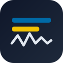
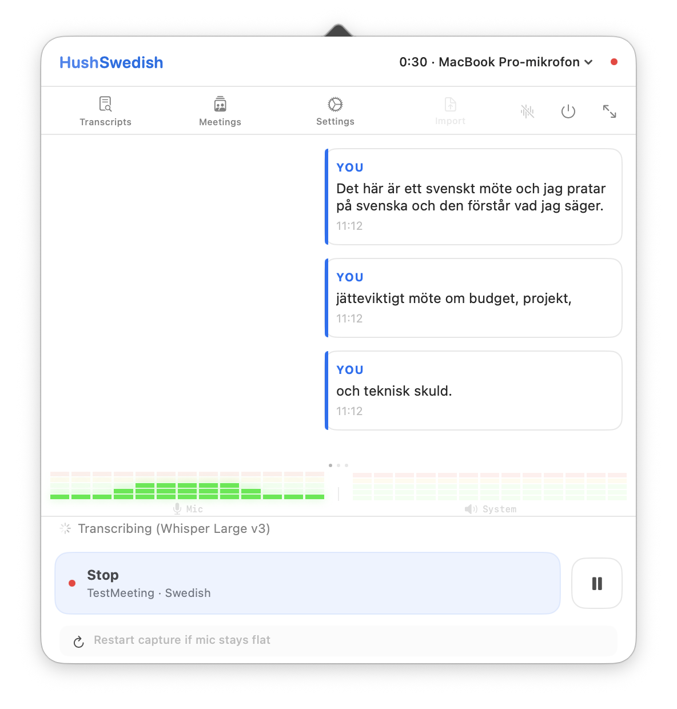
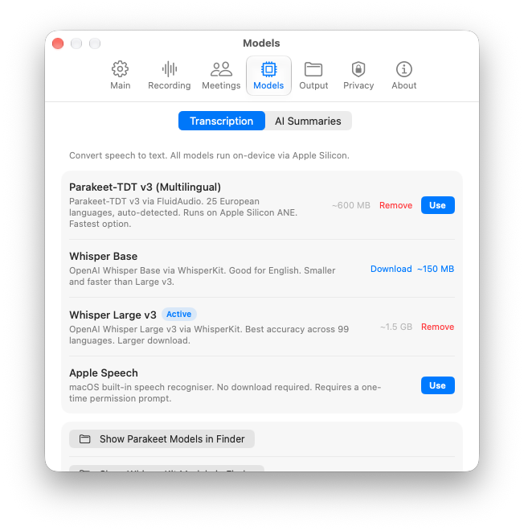
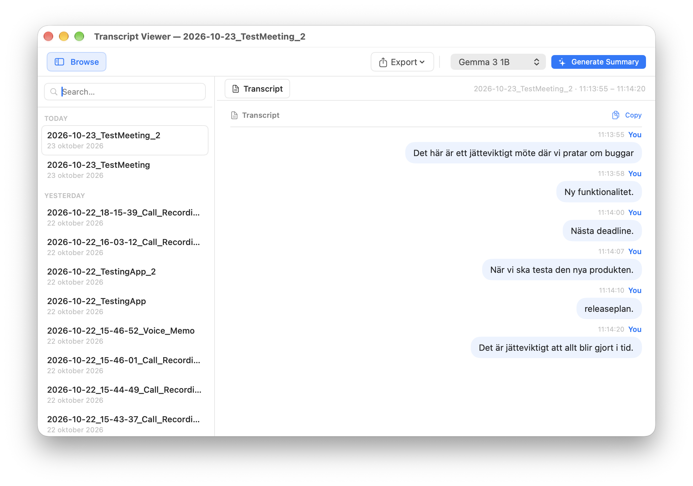
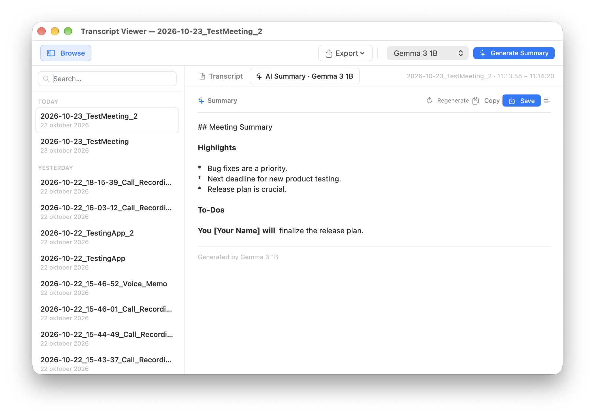

<p align="center">
  
</p>

<h1 align="center">HushSwedish</h1>

<p align="center">
  <strong>On-device meeting & voice transcription for macOS — built for Swedish and English.</strong><br/>
  Privacy first. No cloud. No API keys. Markdown transcripts and summaries.
</p>

<p align="center">
  
  
  
  
</p>

---

HushSwedish is a **personal fork** of [HushScribe](https://github.com/drcursor/HushScribe) ([hushscribe.app](https://hushscribe.app/)). It is **not** affiliated with or maintained by the upstream project. Same local-first idea — menu bar capture, on-device models, `.md` transcripts and summaries (perfect for Obsidian). Changes tuned for **Swedish meetings** 

It can also be used **next to** the official app (`com.drcursor.hushscribe` vs `com.hushswedish.app`).

<p align="center">
  
  
</p>

## Changes from original HushScribe

| Topic | Upstream | HushSwedish |
|--------|----------|-------------|
| Default ASR model | Parakeet-TDT v3 | **Whisper Large v3** |
| Session language | Auto / model-default | **SV or EN** before each recording |
| Transcript filenames | Timestamp + label | Optional **`yyyy-MM-dd_Your_title.md`** |
| Pause / Stop | Can drop trailing speech | **Flushes last sentence** through ASR first |
| Voice Memo | Starts system-audio capture | **Mic only** (no screen-recording prompt) |
| Parakeet download | Could block other models | **Only when Parakeet is selected** |
| App identity | HushScribe | **HushSwedish**, separate prefs & vaults |
| Default vaults | HushScribe folders | **`~/Documents/HushSwedish/Meetings`** & **`Voice`** |
| Model cache on disk | Shared system paths | **Same** — no second Whisper download if you use both apps |
| Summary model download | Loads the model into MLX as it downloads | **Downloads the files only**, so a missing Metal library cannot quit the app |
| Model RAM | Stays loaded until you quit | **Warm on menu open**, **idle offload** (30 min / 1 h / 2 h), **memory-pressure** unload |
| When to start speaking | Session starts immediately or fixed pre-roll | **“Getting ready…”** until capture is live; waveform + **Transcribing** state = safe to talk |
| Stalled mic / system audio | Hidden recovery gesture | **Restart capture** button while recording (+ hint if mic meter stays flat) |
| Colleagues & meeting titles | Manual transcript naming only | **Meetings and speakers** — roster + weekday/time **default transcript names** |

**Also in this fork:**

- Whisper decoding uses explicit **`sv` / `en`** (transcribe, not translate); default session language **Swedish**; `transcription_language` in frontmatter.
- Transcript Viewer **dedupes** files when Meetings and Voice point at the same folder.
- Local **`scripts/release.sh test`** ad-hoc-signs when no Developer ID is configured (screen-recording permission may need re-granting after rebuilds).
- **`scripts/release.sh`** builds **`mlx.metallib`** into the app. Without it, generating a summary quits the process. The script stops if the Metal toolchain is missing (`xcodebuild -downloadComponent MetalToolchain`).
- **Model warm-up / offload:** opening the menu bar popover preloads the selected ASR model (when already downloaded). After you close the UI, models leave RAM after **Settings → Recording → Memory** (default **1 hour**). macOS **memory pressure** can unload sooner. Re-open the menu to warm again — no re-download.
- **Ready-to-transcribe overlay:** tapping **Call Capture** or **Voice Memo** shows **“Getting ready…”** while models load (if needed) and capture starts. The overlay clears when the session is actually recording (waveform active, status shows transcribing). **Wait for that** before you speak — duration depends on warm vs cold load, not a fixed timer.
- **Restart capture:** if the mic or system meter stays flat or text stops updating, use **Restart capture** under Stop/Pause (restarts audio pipelines without ending the session). Settings → Recording explains picking a fixed mic vs System Default.
- **Download gate:** Call Capture / Voice Memo stay disabled until the selected transcription model is on disk; the main view recommends **Whisper Large v3** (SV/EN) or **Parakeet** (English-only).
- **Meetings and speakers** (menu **Meetings**, status bar menu, or **Settings → Open Meetings and speakers…**):
  - **Speakers** — save people you meet with often; after Call Capture, tap a **colleague chip** (or type) when renaming **Speaker 2, 3…** in the transcript.
  - **Meetings** — rules like “Mon–Fri **09:00** → title **Standup**”. While you are in the slot (**5 min before** through **20 min after** that time), the popover shows a **Suggested** title chip; **Call Capture**, **file import**, and **auto-record** use the rule title when **Name** is empty (you can still type a custom name or tap the chip first).

Full details: [docs/changes-from-hushscribe.md](docs/changes-from-hushscribe.md) · Language design: [docs/plan-recording-language-sv-en.md](docs/plan-recording-language-sv-en.md)

## System requirements

### To run the app

| | |
|---|---|
| **OS** | **macOS 26** or later |
| **Hardware** | **Apple Silicon** (M-series). Intel Macs are not supported — ASR and optional summaries rely on on-device WhisperKit, FluidAudio, and MLX. |
| **Microphone** | Required for all recording modes |
| **Screen & system audio** | Required for **Call Capture** only (captures meeting participants). **Voice Memo** uses the mic only. |
| **Disk space** | About **2 GB** free for the default **Whisper Large v3** download (~1.5 GB) plus VAD and caches. **Parakeet** is ~600 MB; **Whisper Base** ~150 MB. Optional summary models are separate downloads. Model files are shared with [HushScribe](https://github.com/drcursor/HushScribe) if both apps are installed. |
| **Memory** | Plan for roughly **4 GB+ free RAM** while transcribing with Whisper Large (the loaded model is often **~1–3 GB**). Models can be unloaded after idle time (**Settings → Recording → Memory**, default 1 hour) when the menu window is closed. |
| **Network** | Needed to **download models** from Hugging Face when you choose them in Settings. **Transcription and summaries do not use the cloud** once models are on disk. |

### To build from source

| | |
|---|---|
| **Xcode** | **26+** with **Swift 6.2** (see `HushSwedish/Package.swift`) |
| **Metal Toolchain** | Required to bundle `mlx.metallib` for **AI summaries** — install with `xcodebuild -downloadComponent MetalToolchain` if `scripts/release.sh` reports it missing. Transcription-only use does not need MLX at runtime until you generate a summary. |

## Install (build from source)

No Homebrew cask for this fork yet.

```bash
git clone https://github.com/Sofiakodar/HushSwedish.git
cd HushSwedish
scripts/release.sh test
open dist/HushSwedish.app
```

Developer-only binary:

```bash
cd HushSwedish
swift build -c release
# HushSwedish/.build/release/HushSwedish
```

Signed DMG / notarization: your Apple Developer ID in `scripts/release.sh`. Layout: [ARCHITECTURE.md](ARCHITECTURE.md).

**Official HushScribe** (Homebrew / DMG): [drcursor/HushScribe](https://github.com/drcursor/HushScribe).

## Day-to-day use

1. **Download** your ASR model once in **Settings → Models** (default for Swedish: **Whisper Large v3**).
2. Optional: open **Meetings and speakers** once to add **colleagues** and **meeting rules** (weekday + time → default transcript title for Call Capture / file import).
3. Open the menu bar app — models **warm in the background** while you set **SV/EN**, optional **name** (or tap a **Suggested** meeting title when a rule matches), then **Call Capture** or **Voice Memo**. Wait until **Getting ready…** disappears and the waveform is live before speaking.
4. After a multi-speaker call, use **Name Speakers** to assign **colleague** names to diarized lines.
5. Transcripts land as Markdown (+ YAML) in the folder of your choosing (for example an Obsidian vault).
6. During a long session, if audio seems stuck, tap **Restart capture** (see [Limitations](#limitations)).
7. **Transcript Viewer** → browse, export, optional on-device **summary** (Qwen3, Gemma, Apple NL).

Close the popover when done; transcription models **drop from RAM** after the idle interval you chose (default 1 hour) so the app can stay in the menu bar without holding ~1–3 GB. Open the menu again before the next meeting to warm up.

Nothing is sent to the internet for transcription or summarization; models download from Hugging Face when you choose them in **Settings → Models**.

## Transcription models

| Model | Notes |
|-------|--------|
| **Whisper Large v3** | Default; use with session **SV** for Swedish meetings |
| Whisper Base | Smaller WhisperKit model |
| Parakeet-TDT v3 | English-only meetings; auto-detect |

## Summary models (optional)

Apple NL (default), Qwen3 0.6B, Gemma 3 1B, Gemma 4 E4B — all on-device via MLX. See upstream model links in [HushScribe README](https://github.com/drcursor/HushScribe#models).

## Example output

```markdown
---
type: meeting
created: "2026-10-21"
transcription_language: "sv"
source_app: "Zoom"
tags:
  - source/hushswedish
---

# Projektavstämning — 2026-10-21 14:30

**You** (14:30:03)
Vi går igenom release-planen.
```

<p align="center">
  
  
</p>

## Privacy

On-device ASR and summaries; no analytics or telemetry in the app design; **text only** on disk (no saved audio). Network use is essentially **model downloads** when you opt in.

## Permissions

| Permission | When |
|------------|------|
| Microphone | Always |
| Screen & system audio | **Call Capture** only |

## Limitations

Apple Silicon + macOS 26+; post-session diarization; browser meetings not auto-detected; **KB-Whisper** not integrated yet.

**Audio stalls:** macOS or Bluetooth can sometimes leave mic/system capture running but silent (flat meters, no new transcript lines). Prefer a **specific microphone** in **Settings → Recording** instead of System Default. While recording, use **Restart capture** at the bottom of the control bar; an orange hint appears if the mic meter stays flat for ~10 seconds while you are unmuted. Window hidden from screen share by default (`com.hushswedish.app` prefs).

## Credits & license

Fork of **[HushScribe](https://github.com/drcursor/HushScribe)** → [Tome](https://github.com/Gremble-io/Tome) → [OpenGranola](https://github.com/yazinsai/OpenGranola). Engines: [FluidAudio](https://github.com/FluidInference/FluidAudio), [WhisperKit](https://github.com/argmaxinc/WhisperKit), [mlx-swift-lm](https://github.com/ml-explore/mlx-swift-lm), pyannote diarization, and vendor LLMs on Hugging Face.

**[MIT](LICENSE)** — keep copyright notices when redistributing.

Fork changelog: [CHANGELOG.md](CHANGELOG.md) (fork notes under **Unreleased**).
